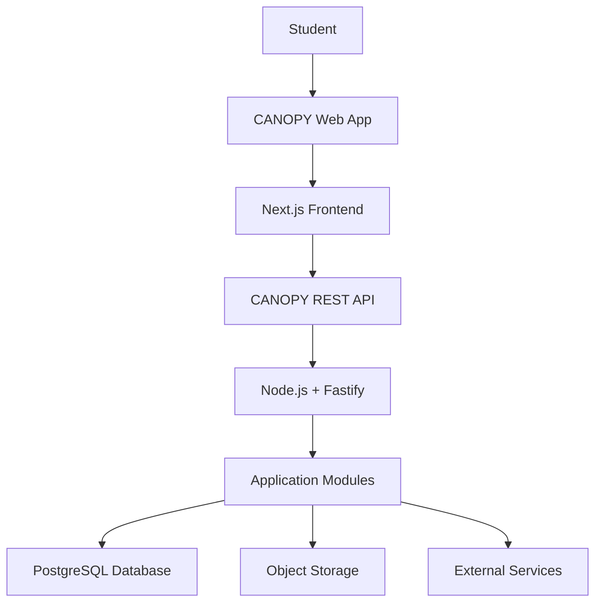

# 🌿 CANOPY

### A student-centered platform for learning, sharing, and discovering knowledge.

CANOPY is a platform designed to bring students closer to the academic resources, learning tools, and knowledge they need throughout their educational journey.

The vision is to create a unified learning ecosystem where students can discover study materials, share knowledge, organize resources, and access tools that make learning more effective.

> Built from scratch, one step at a time.

---

## 🚧 Project Status

CANOPY is currently in its early development stage. The project is being built from scratch, beginning with the backend infrastructure and gradually expanding into a complete student platform.

| Area                  | Status         |
| --------------------- | -------------- |
| Project planning      | 🟢 Completed   |
| Backend foundation    | 🟡 In progress |
| Database architecture | ⚪ Planned     |
| Authentication        | ⚪ Planned     |
| Resource management   | ⚪ Planned     |
| API ecosystem         | ⚪ Planned     |
| Frontend              | ⚪ Planned     |
| Deployment            | ⚪ Planned     |

---

## 🎯 Vision

The goal of CANOPY is to build more than a repository of academic notes. It aims to become a digital environment where students can:

- 📚 Access and discover academic resources.
- 📝 Share notes, summaries, and learning materials.
- 🔎 Search for relevant study content.
- 🔖 Save and organize useful resources.
- 👥 Learn from resources shared by other students.
- 🧰 Access tools that support their academic journey.
- 🔌 Utilize an API that enables integrations with other applications.

---

## ✨ Planned Features

### 📖 Learning Resources

A centralized library for academic materials, including notes, revision materials, past papers, summaries, and other educational content.

### 🔍 Discovery & Search

Explore resources through categories, tags, search, and personalized discovery.

### 👤 Student Accounts

User profiles, authentication, and personalized experiences.

### 🔖 Personal Workspace

Save resources, build collections, and keep track of useful learning materials.

### 📤 Resource Sharing

Allow students to contribute resources and share knowledge with the wider learning community.

### 🔌 CANOPY API

A versioned REST API designed to support CANOPY's frontend and potential third-party integrations.

### 🧠 Future Learning Tools

Explore intelligent study tools, resource analysis, revision assistance, and other learning-focused features.

---

## 🏗️ Technology Stack

### Backend

- [Node.js](https://nodejs.org/) — Runtime
- [TypeScript](https://www.typescriptlang.org/) — Type-safe development
- [Fastify](https://fastify.dev/) — Backend framework
- [Zod](https://zod.dev/) — Validation

### Database

- [PostgreSQL](https://www.postgresql.org/) — Relational database
- [Prisma](https://www.prisma.io/) — ORM and database tooling

### Frontend

- [Next.js](https://nextjs.org/) — Web application framework

### Testing & Tooling

- [Vitest](https://vitest.dev/) — Testing framework
- Git & GitHub — Version control and collaboration

---

## 🏛️ Architecture

CANOPY is being designed with a modular architecture to keep its components maintainable as the platform grows.



The initial backend will follow a modular structure, separating application configuration, routes, business logic, database operations, and infrastructure integrations.

---

## 📁 Project Structure

The planned structure will evolve as development progresses.

```text
canopy/
├── docs/
│   ├── ARCHITECTURE.md
│   ├── DECISIONS.md
│   ├── JOURNEY.md
│   ├── API.md
│   └── journal/
├── src/
│   ├── config/
│   ├── modules/
│   ├── plugins/
│   ├── routes/
│   ├── app.ts
│   └── server.ts
├── prisma/
├── tests/
├── .env.example
├── .gitignore
├── package.json
└── README.md
```

---

## 🗺️ Development Roadmap

- [x] Define the project vision
- [x] Establish initial technology choices
- [x] Begin project documentation
- [ ] Build the backend foundation
- [ ] Configure the database
- [ ] Implement authentication and authorization
- [ ] Develop the resource management system
- [ ] Build search and discovery
- [ ] Implement the CANOPY API
- [ ] Develop student workspace features
- [ ] Build the frontend
- [ ] Test, secure, and optimize
- [ ] Deploy the platform
- [ ] Launch beta

---

## 📓 Building in Public

CANOPY is being developed from scratch, and the journey is being documented along the way.

This includes:

- Development progress and milestones
- Technical decisions and their reasoning
- Lessons learned
- Bugs, challenges, and solutions
- Architecture evolution

The goal is not just to finish the project, but to understand the engineering behind building and maintaining a real-world application.

---

## 📚 Documentation

Project documentation and development notes will be maintained in the [`docs/`](docs/) directory.

| Document                                 | Description                          |
| ---------------------------------------- | ------------------------------------ |
| [Development Journey](docs/JOURNEY.md)   | Milestones and overall progress      |
| [Architecture](docs/ARCHITECTURE.md)     | System architecture                  |
| [Technical Decisions](docs/DECISIONS.md) | Engineering decisions and reasoning  |
| [API Documentation](docs/API.md)         | API design and endpoints             |
| [Development Journal](docs/journal/)     | Session-by-session development notes |

---

## 🤝 Contributions

CANOPY is currently under active development. Contribution guidelines will be established as the project matures.

---

## 📄 License

The licensing model has not yet been determined.

---

<p align="center">
  Made with 🌱 while building something meaningful for students.
</p>
